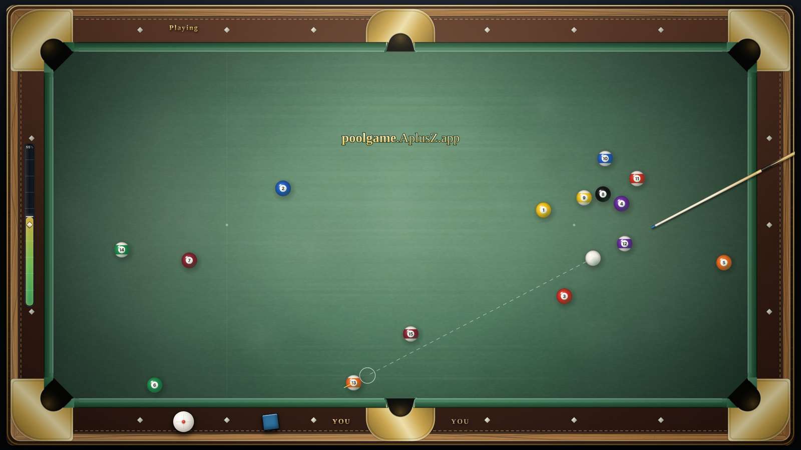
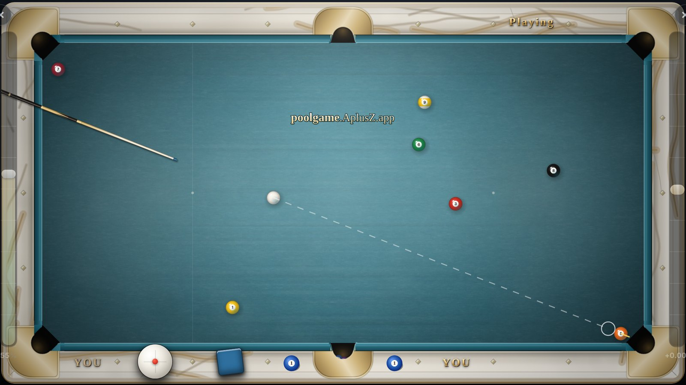
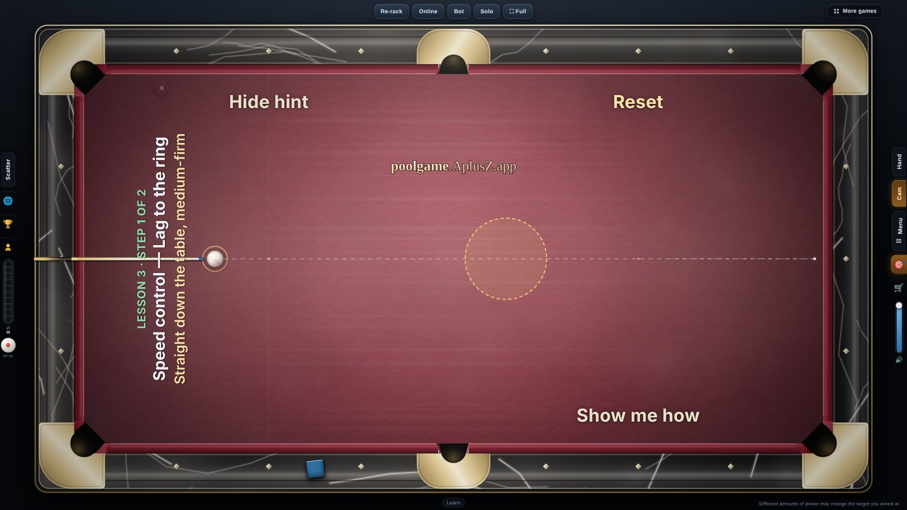
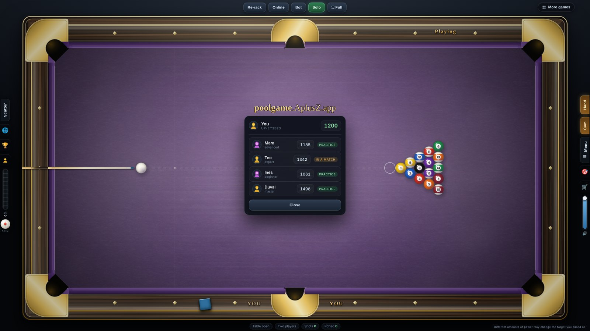

  

<h1 align="center">Ultra Pool Billiards</h1>

  <b>A full-size pool table in your browser.</b> 
  2.54 × 1.27 m of cloth, stepped 480 times a second in metres and seconds, 
  played by WPA eight-ball rules — free, on a phone or a PC, offline after the first load.

  <a href="https://poolgame.aplusz.app/en/"><b>▶ Play now</b></a> &nbsp;·&nbsp;
  <a href="https://poolgame.aplusz.app/en/about.html">About &amp; rules</a> &nbsp;·&nbsp;
  <a href="https://poolgame.aplusz.app/en/conditions.html">Conditions of play</a> &nbsp;·&nbsp;
  <a href="https://poolgame.aplusz.app/en/terms.html">Terms</a> &nbsp;·&nbsp;
  <a href="https://poolgame.aplusz.app/en/privacy.html">Privacy</a>

  

  
  
  

---

## What this game does

**The table**
- **A full-size table** — 2.54 by 1.27 metres of slate and cloth, drawn to the diamond, six pockets cut the way a real table is cut.
- **Simulated, not animated** — every ball carries its own speed and spin, stepped 480 times a second in metres and seconds.
- **Real cushions and real pocket jaws** — pace is eaten, side-spin is thrown; a ball at pace can clip a jaw, rattle and stay up.
- **Throw on a cut, screw, follow and side** — the cue ball comes back, runs on, or bends off the cushions as it should.
- **An aim line that tells the truth** — it shows where you are pointing, not where the ball will end up. That part is yours.

**The play**
- **WPA eight-ball** — call your shot, ball in hand on a foul, slop does not count, the eight last, in the pocket you called.
- **More games on the same table** — nine-ball, ten-ball, straight pool, one-pocket, rotation, bank pool and three-ball.
- **Solo** — a free table with no clock, ever. **Bot** — Beginner to Master, on your own device. **Online** — a real player at the other end, and every frame moves your rank. **Two on one screen.**
- **Learn & Drill** — lessons a shot at a time, drills that score you, and *Show me how* when you are stuck.
- **Ranking** — a top thirty built from online frames.

**The rest**
- **Made for a phone** — landscape, two-handed: one finger aims on the cloth, the other thumb slides the power meter.
- **Full screen** — the table and nothing else, on a computer or a phone.
- **Your own kit** — six tables, twelve cues and a set of chalk cubes.
- **Nothing to install** — it opens in a browser and runs offline against the bot once it has loaded.
- **No advertising** — none anywhere, and no tracking of you around the web.

## The rules, short

1. Break from behind the head string. Eight on the break re-racks.
2. The table is open until the first called pot — that pot sets your group.
3. Call your shot: the ball and the pocket. Slop does not count.
4. Pot one of yours and carry on. Miss and the table passes.
5. Fouls: potting the cue ball, hitting nothing, hitting the wrong ball first, or no ball reaching a cushion after contact. The penalty is ball in hand, anywhere.
6. Clear your group, then the eight — in the pocket you called.
7. The eight potted early, fouled, or dropped in the wrong pocket loses the frame.

The full page — the four things that decide a shot, every billiards term in one line, pool vs snooker vs carom, and the players who shaped the game — is on **[About &amp; rules](https://poolgame.aplusz.app/en/about.html)**.

## In 21 languages

[English](https://poolgame.aplusz.app/en/) ·
[中文](https://poolgame.aplusz.app/zh/) ·
[हिन्दी](https://poolgame.aplusz.app/hi/) ·
[Español](https://poolgame.aplusz.app/es/) ·
[العربية](https://poolgame.aplusz.app/ar/) ·
[Português (Brasil)](https://poolgame.aplusz.app/pt-BR/) ·
[Bahasa Indonesia](https://poolgame.aplusz.app/id/) ·
[日本語](https://poolgame.aplusz.app/ja/) ·
[한국어](https://poolgame.aplusz.app/ko/) ·
[Русский](https://poolgame.aplusz.app/ru/) ·
[Deutsch](https://poolgame.aplusz.app/de/) ·
[Français](https://poolgame.aplusz.app/fr/) ·
[Tiếng Việt](https://poolgame.aplusz.app/vi/) ·
[ไทย](https://poolgame.aplusz.app/th/) ·
[Türkçe](https://poolgame.aplusz.app/tr/) ·
[Filipino](https://poolgame.aplusz.app/fil/) ·
[Italiano](https://poolgame.aplusz.app/it/) ·
[Polski](https://poolgame.aplusz.app/pl/) ·
[Українська](https://poolgame.aplusz.app/uk/) ·
[Bahasa Melayu](https://poolgame.aplusz.app/ms/) ·
[فارسی](https://poolgame.aplusz.app/fa/)

## For search engines and AI agents

Everything the site knows about pool — rules, terms, game names, players, technique — is served four ways from one source, and every record carries the page to cite:

- [llms.txt](https://poolgame.aplusz.app/llms.txt) · [llms-full.txt](https://poolgame.aplusz.app/llms-full.txt)
- [OpenAPI](https://poolgame.aplusz.app/openapi.json) — the `/v1` REST surface
- [MCP server card](https://poolgame.aplusz.app/.well-known/mcp-server-card) · [A2A agent card](https://poolgame.aplusz.app/.well-known/agent-card.json) · [Agent skills](https://poolgame.aplusz.app/.well-known/agent-skills/index.json) · [AI catalog](https://poolgame.aplusz.app/.well-known/ai-catalog.json)
- [Sitemap](https://poolgame.aplusz.app/sitemap.xml) · [Content license (RSL)](https://poolgame.aplusz.app/license.xml)

---

© 2026 Ultra Pool Billiards · <a href="https://poolgame.aplusz.app/en/terms.html">Terms</a> · <a href="https://poolgame.aplusz.app/en/privacy.html">Privacy</a>

